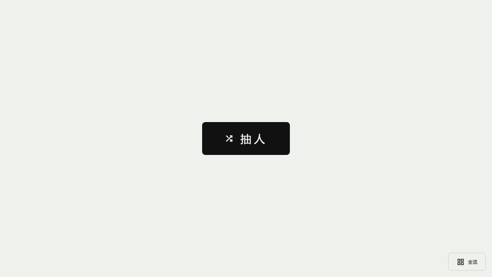
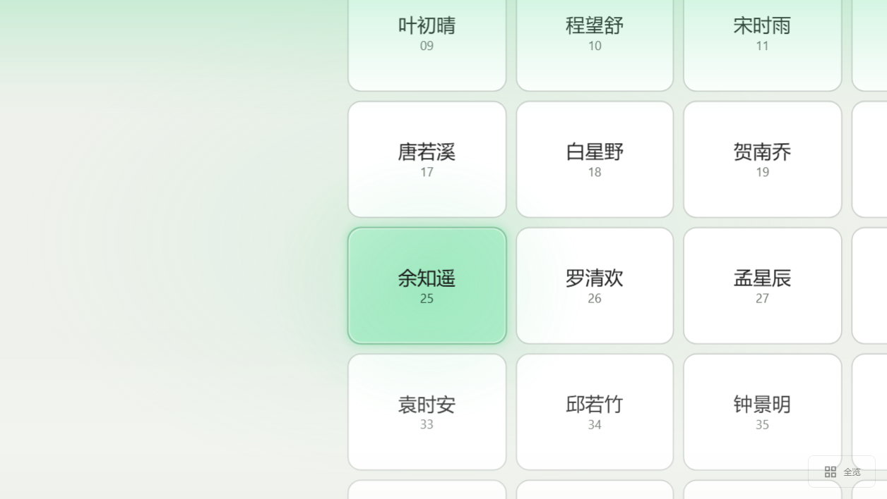
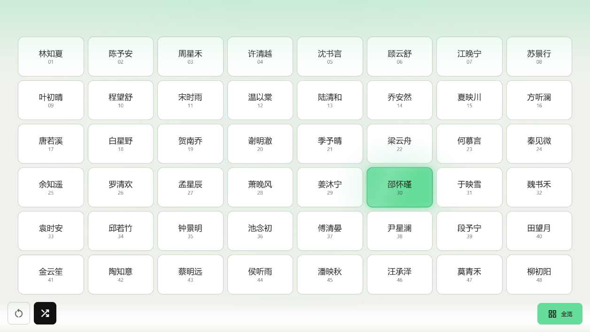
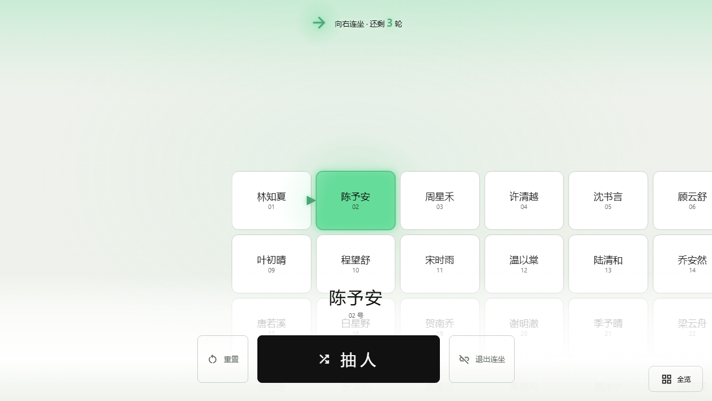
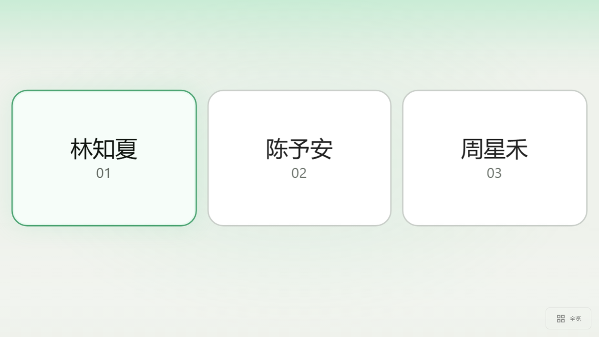
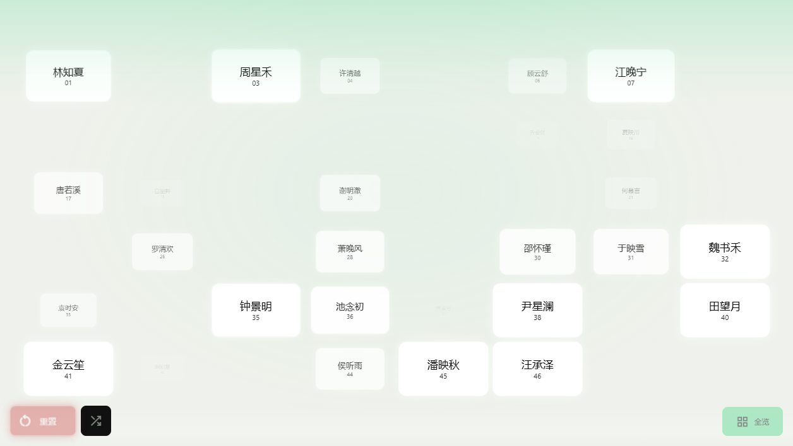

<p align="center">
  
</p>

<h1 align="center">SlateRandom 岩选</h1>

<center>
  <h3>更好玩好用的随机抽选</h3>
  给课堂、班会和活动用的随机抽人工具。导入名单，点一下「抽人」，它会从还没被抽到的同学里挑一个。<br>
  抽选不联网，名单和数据只留在本机。
</center>

> [!WARNING]
> 本项目属于「岩酱的奇思妙想」系列，代码主要由人工智能生成并维护。请在使用前充分评估其安全性、可靠性与适用性，并谨慎用于生产环境。

<details>
<summary>界面截图</summary>
<p align="center">
  
  <br>
  
  <br>
  
  
</p>
<p align="center"><sub>主页 · 抽人 · 全览 · 连坐 · 友尽选人过程 · 重置退场动画；亮色主题并开启背景颜色扩散，使用预设的「星河班」示例名单。</sub></p>
</details>

## 为什么不用 `Math.random()`

当然可以，但上几次课之后，你大概率会听到「怎么又是 ta」和「我怎么一次都没被抽到」。

SlateRandom 做了几件很朴素的事：

- 本轮没被抽到的同学优先；
- 长期抽得少、经常排在后面出场的人，权重会慢慢补上来；
- 刚抽到的人进入短期冷却，避免连续点名；
- 「重置本轮」只清掉本轮进度、本轮次数和冷却，累计统计不动。

它不保证每个人每节课都绝对一样多，但不会让同一个人一直倒霉。

## 两个版本

| | Windows 桌面版 | Lite 单文件版 |
| --- | --- | --- |
| 适合 | 固定电脑上课，想要悬浮球和开机自启 | 临时用、换电脑、不想安装 |
| 启动 | 解压后双击 `SlateRandom.exe` | 双击 HTML |
| 特色 | 悬浮球、通知区图标、不占任务栏 | 可全屏，规则和桌面版一致 |
| 数据 | 程序旁边的 `data/` | 浏览器本地存储 |

两个版本可以通过「数据 → 导出全部」生成 `.slate` 备份，再到另一边「恢复全部」。

### Windows 桌面版

1. 解压 `SlateRandom-1.0.0-windows-x64.zip`。ARM64 设备用 `...-arm64.zip`。
2. 在完整文件夹里双击 `SlateRandom.exe`。
3. 第一次打开是空名单，不是坏了。先去「名单」导入自己的班级。

不用装 Node.js、pnpm，也不用管理员权限。请保留整个文件夹，不要只把 exe 拖走；换电脑时直接复制整个目录，`data/` 别忘了。

启动后屏幕边上会出现一个绿色悬浮球。拖动换位置，靠近左右边缘会吸附。点它打开置顶主界面，收起后回到球。主界面不占任务栏，托盘图标也能打开、收起和退出。

关闭按钮只会收起主界面。真要退出，长按悬浮球 3 秒，再点确认。

桌面版可以在「设置 → 通用」里打开开机自启，并按需选择提权方式。普通上课不用动这些。旧版本首次升级时，程序会把 `%APPDATA%/SlateRandom` 里的数据复制到程序旁的 `data/`，旧目录仍然保留。

### Lite 单文件版

双击 `dist/index.html` 或发布包里的 `SlateRandom-Lite.html` 就能用，标题会显示「SlateRandom 岩选 Lite」。

Lite 的数据存在浏览器里，和文件路径、浏览器绑定。**移动或改名 HTML 之前，先在「数据」页导出全部备份**，不然浏览器可能找不到原来的记录。桌面版没有这个问题。

悬浮球、自启和提权控件在 Lite 里不会出现，其余抽选和设置功能一致。

## 导入名单

点「名单」导入 UTF-8 的 TXT / CSV。一行一位同学：

```text
张三
2026001,李四
2026002,王五,2,3
```

三种写法分别是「姓名」「学号,姓名」「学号,姓名,行,列」。

也支持 Excel 和座位表图片。图片识别需要先在设置里配置视觉服务；识别结果会先让你核对，不会替人编学号或座位。

人数上限 500 人、50 行、20 列。手动写坐标时可以保留空座。导入后还能改班级名、交换座位、暂停某位同学，或按新行列重新排座。

## 抽人

| 操作 | 结果 |
| --- | --- |
| 轻点（不到 200 ms） | 抽一位 |
| 按住 200～500 ms 再松手 | 取消这次抽取 |
| 按住满 500 ms | 打开设置 |
| 空格 | 和「抽人」按钮一样 |
| 长按 R 500 ms | 重置本轮 |
| Q | 退出连坐 |
| Esc | 关闭最上层窗口 |

按住时按钮里的进度会填满，松手后倒回去。在输入框里打字时，空格、R、Q 不会抢按键；Esc 还是关窗口。

## 几种抽法

- **普通随机**：按公平权重从可抽同学里选。
- **连坐**：从当前同学向外找邻座，方向每轮重新随机，可以设置持续轮数和冷却范围。
- **时间**：拿当前日期或时间里的数字去对应学号；取位失效会自动换，实在没有可用取位就回退到其他方式。
- **友尽**：给某位同学提前设好目标，下次抽人时有概率优先从目标里抽。默认 20%，独立触发，不占其他模式的概率。
- **混合 / 指定模式**：普通、连坐、时间可以按百分比混合。普通始终保留，连坐和时间的概率合计不能超过 100%，剩下的归普通。想固定一种就选「指定模式」。

「结果跳变」默认有 30% 概率在有效候选里再改一次最终结果，纯节目效果。它仍受冷却、未抽优先和长期公平保护；关掉就完全按正常规则。

## 外观

「设置 → 通用」里可以调主题、主题色、圆角和背景扩散，也能让 AI 根据一句话生成一套配色，或者自己贴 CSS。主题只保存在本地，随设置备份一起迁移。

右下角的「全览」会把整张座位表铺开，适合投影；再点一次回到普通视图。座位太密时，普通模式会自动把镜头跟到当前同学，全览则始终显示完整座位表。

## 朗读

「功能 → 朗读设置」里可以打开姓名朗读。桌面版默认用 Edge TTS 的晓晓，Lite 默认用浏览器自带语音，也可以接 MiMo 或兼容服务。

桌面版会把合成过的姓名语音缓存到 `data/cache/tts`，默认上限 64 MiB，可以随时清空。

## 数据、备份和隐私

「数据」页会记录每位同学的累计次数、平均出场先后、当前概率、冷却状态和最近记录。最近明细保留 2000 条；累计统计不会因为重置本轮或日志截断而丢失。

可以单独导出设置、名单，也可以导出包含名单、设置、统计、历史和当前进度的 `.slate` 全部备份。

如果准备发 Issue，数据页下面还有一个「导出分析数据」。它会生成一份 JSON，包含运行环境、匿名化后的名单统计和最近 200 条记录，方便排查问题。报告里没有姓名、学号、班级名、抽取说明、自定义 CSS、密钥、凭据或文件路径；学生只会以 `S01`、`S02` 这样的匿名键出现。

API 密钥默认不进入备份。确实要迁移时再勾选「备份中包含 API 密钥」。这个选项没有密码保护，文件别乱发。

桌面版移动时，复制整个程序目录。`statistics.srstat` 需要旁边的 `.fairness-key` 才能通过校验，别只单独拿走统计文件。

抽选、座位、动画和统计都不需要网络。只有你主动使用图片识别或远程朗读时，才会把对应图片、参考表或当次姓名发给你配置的服务。密钥默认只留在本机。

## 常见问题

**要安装什么吗？** 不用。桌面版解压即用，Lite 打开 HTML 即用。只有从源码开发才需要 Node.js 和 pnpm。

**没网能上课吗？** 能。核心功能离线，在线语音和图片识别是可选增强。

**会一直抽到同一个人吗？** 本轮优先没抽到的人，全班轮满后自动开新一轮。长期权重和冷却会继续压着「手气太好」的人。

**Mac / Linux 能用吗？** 桌面版目前只有 Windows 构建；其他系统用 Lite。

**第一次打开为什么没有名字？** 程序不会自动造示例名单。测试数据只存在于开发回归里。

**ARM64 版稳吗？** 能构建，但还没在真实 ARM64 Windows 设备上完成最终验收。不确定就先用 x64；试过的话欢迎告诉作者。

**「全部备份」和「分析数据」有什么区别？** 全部备份是给另一台设备恢复用的，包含完整数据和密钥选项；分析数据只用来贴 Issue，不能恢复，也不含个人身份信息。

## 开发

项目用 Vue 3、TypeScript、Vite 和 Electron。需要 Node.js 22.12+，pnpm 版本以 `package.json` 里的 `packageManager` 为准。

```sh
pnpm install --frozen-lockfile
pnpm dev          # 本地开发
pnpm check        # Vue / TypeScript 类型检查
pnpm test         # 单元测试（需要 Windows；会先构建权限辅助程序）
pnpm build        # 生成单文件 dist/index.html
```

桌面版开发和打包：

```sh
pnpm desktop:install
pnpm desktop:dev
pnpm desktop:build
```

Windows 上还可以用 `pnpm verify` 跑类型检查和完整单元测试，生成 `qa-output/modern-toolchain-report.json`。

更多实现细节：

- [架构说明](docs/ARCHITECTURE.md)
- [便携数据](docs/PORTABLE_DATA.md)
- [Windows 权限与提权](docs/PRIVILEGES.md)
- [渲染与性能](docs/RENDERING.md)
- [第三方组件与许可证](THIRD_PARTY_NOTICES.md)

## 许可

Copyright © 2026 [DeepslateQAQ](https://github.com/DeepslateQAQ)。

原创代码采用 **GNU GPL 第 3 版或更新版本（GPL-3.0-or-later）**，可以按许可条款修改和再分发，不提供担保。分发应用时请按 GPL 提供相应源代码。第三方组件沿用各自许可证，详见 [THIRD_PARTY_NOTICES.md](THIRD_PARTY_NOTICES.md)。

---

如果它帮到了你的课堂，或者你发现哪里用着别扭，欢迎告诉作者。祝每次抽人都刚刚好。
