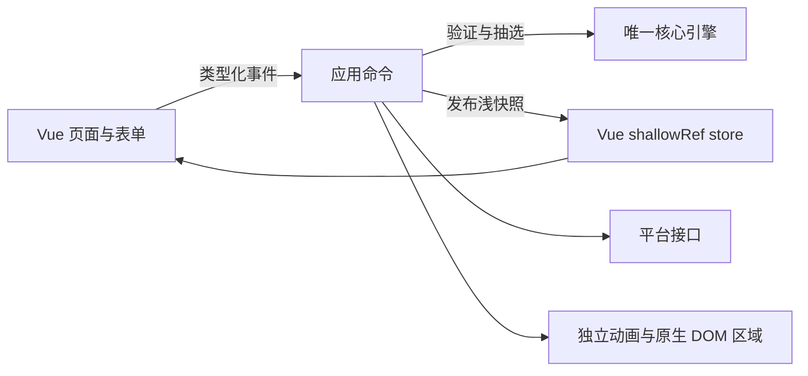

# SlateRandom 岩选架构与扩展边界

作者：[DeepslateQAQ](https://github.com/DeepslateQAQ)。

开发源码使用 Vue 3、TypeScript、Vite 7 和 pnpm，同时交付单文件 HTML 与 Windows Electron 应用。界面控制与抽选算法分层，动画帧在独立的原生 DOM 区域更新，不让整页 Vue 状态跟随每帧镜头变化。

## 数据与命令

`src/shared/domain/model.ts` 定义班级、学生、设置、抽选记录和公平统计 DTO。`src/shared/domain/engine.js` 仍是唯一算法实现；`src/renderer/domain/engine.ts` 是类型化边界，复用同一个实现。不要在 Vue 组件或新 TypeScript 文件复制一套随机数、概率或备份迁移逻辑，否则旧种子、撤销和跨会话公平数据会产生分歧。

应用控制器拥有可变领域状态，在命令边界验证设置、调用引擎、保存记录并发布视图。`src/renderer/application/store.ts` 使用 `shallowRef`，初始化和每次 `publish` 都复制领域状态，因此 Vue 接收的快照不会共享控制器的嵌套可变引用。`shallowReadonly` 保护顶层发布入口；嵌套对象按只读约定使用，并非逐层冻结。镜头位置、旋转角度和每帧高亮不进入这个 store。

Vue 页面使用真实模板与 `props` / `emits`。`ModeSettings.vue` 的未提交数字字符串是组件草稿，只有 `change` 才发出命令。控制器在成功或拒绝验证后更新 `validationRevision`，组件据保存值恢复输入。重新发布快照不应打断正在编辑的文本或重建控件节点。

配置导航固定为通用、功能、名单、数据、帮助、关于六页。系统窗口与权限在通用页，模式概率与模式详情在功能页，座位和友尽目标在名单页；所有备份和累计统计集中在数据页。`dashboard` 保留为功能页内部标识，旧 `history` 路由映射到 `data`。Lite 不渲染桌面关闭控件或桌面设置。

功能页第五行将 `endJumpEnabled` 与 `endJumpChance` 作为独立的结果跳变开关和概率；关闭时保留概率，不参与普通／连坐／时间的 100% 合计。“朗读设置”入口只管理姓名朗读。右下角的 `button#renderStylePicker` 通过原生 click 调用控制器的视图切换，`aria-pressed` 表示全览状态；键盘与触摸使用同一入口，保留全览入退场逻辑，已移除悬浮展开与滑动选择状态。

## 模式语义

友尽先做独立前置判定，不参与普通、连坐、时间的概率总和。友尽未触发后，已有连坐锁定优先；随后才处理指定模式或随机混合。指定模式优先使用 `manualMode`，混合开关只编辑 `settings.modes`，不能随开关改写指定模式。

连坐与时间的保存概率始终要求合计不超过 100%。关闭方式会保留原数值；普通配置行显示启用方式之外的剩余份额。连坐冷却只影响实际可用概率，不重写保存设置。模式详情、开关、风格和视图切换都不能消耗领域随机状态。

`fairnessStats` 保留累计抽中次数、归一位置总和与样本数；`counts`、`lastSeen`、`cycleSeen` 和有上限的 `history` 属于当前抽选状态。统计页通过纯投影展示全部已存统计，不能用最近 2000 条日志反算长期总量。旧记录缺乏出场位置时保留未知，不编造观察样本。

## 动画与原生区域

座位画布、摄像机、方向箭头、时间数字、友尽表情和导入服务保留已有成熟模块。`src/renderer/scene/runtime.js` 装配这些适配器，场景和导入的原生 DOM 模板使用 `v-once` 保持所有权稳定；Vue 不反复修补正在执行 WAAPI、SVG 或 FLIP 动画的子节点。

场景运行时分别处理镜头布局、舞台渲染、抽选序列和导入交互。某个原生 DOM 区域只能由一方更新：Vue 接管的模式行和统计页不再挂旧 DOM 渲染器或重复监听器；动画区域由场景模块管理。控制器通过明确入口串联入场、抽选、实际结果提交与退场，只最终抽中者计入一次。

动画缓动、系统减少动态效果、真实秒钟、500 ms 长按和 200 ms 取消界限各自独立。普通与全览可改变镜头，不能改变同一个种子的抽选分布。电影专用脚本、样式与运行分支已移除，旧 `cinema` / `cinematic` 持久化值由唯一引擎归一为 `normal`，不修改公平统计或随机状态。

## 平台与存储

`src/renderer/platform/ports.ts` 定义 `ClassRepository`、`FilePort`、`FullscreenPort` 和 `FetchPort`。Lite 使用 `BrowserClassRepository` 的 `localStorage`、`BrowserFilePort` 的 Blob 下载与 `BrowserFullscreenPort` 的浏览器全屏；桌面版使用 `DesktopClassRepository` 和 `DesktopFilePort`，通过 preload 调用受限数据接口。控制器从依赖参数接收这些实现。

领域班级 DTO 继续使用 version 1，并由唯一核心校验。Lite 的班级键保持 `rollcall-studio:v1`；无效原文保留在原键和可用的恢复副本中，不将读取失败误当成空班级。桌面仓库将同一 DTO 拆分为可读配置和统计文件，在抽选命令完成时建立同步检查点。

默认状态由 `createEmptyState()` 创建，名单为空；抽选入口在此状态打开名单配置，全览显示不可用提示。旧版自动插入的原始演示名单有独立迁移，实际导入的名单和统计不会因此清除。可选 `seatRows` 保存用户明确指定的布局行数，允许末尾存在完整空座行；旧备份省略它时继续按实际占用行数布局。图像识别则先删除全空轴，再保存整理后的尺寸。

Lite 的视觉和语音提供商使用独立 IndexedDB：`rollcall-studio:providers` 与 `rollcall-studio:speech-providers`。桌面版的提供商配置通过同一服务边界存入 `data/settings.json`，不再将浏览器数据库作为权威副本。两种环境的密钥都不进入名单、领域班级状态、CSV 或源码；设置和全部导出默认移除密钥，显式启用后才携带。

`src/renderer/legacy/provider-transport.js` 在流读取中累计响应字节：视觉 JSON 上限 1 MiB、MiMo JSON 上限 24 MiB、二进制音频上限 16 MiB；不依赖 Content-Length 的可信性，也不退回完整 text/blob 缓冲。取消和 deadline 覆盖挂起的 fetch 与 body，取消 reader 不等待失去响应的 cancel Promise。图片／参考表读取及识别结果各有版本约束，切页、关闭或恢复数据使旧任务失效，迟到任务不能替换新数据或解锁新识别。

`src/main/portable-location.cjs` 在 Electron 创建会话前选择可执行文件旁的 `data/`，开发模式选择项目 `data/`。首次升级复制旧 `%APPDATA%/SlateRandom` 的必要浏览器资料与桌面设置，排除缓存，不修改旧原件，也不覆盖现有便携数据。首次正式加载再把复制资料中的班级、提供商转换为新格式。迁移状态独立记录，已有新检查点始终优先；原件不作为持续同步源。

`src/main/portable-data.cjs` 管理 `roster.json`、`settings.json`、`statistics.srstat` 与 `.fairness-key`。前两者为 JSON；统计包含累计次数、出场位置、当前进度、历史与随机状态，新写入采用 UTF-8 JSON、deflate 和 AES-256-GCM 完整性校验，避免依赖 Electron／Node.js 的 V8 序列化版本。统计文件保留 `SLATEST1` 文件头，其 16 位大端编码版本为 2；领域与文档 schema 仍为 version 1。编码版本 1 的旧 V8 数据继续兼容读取，读取不改写文件，下一次正常保存升级为编码版本 2；无法读取或未知版本会明确报错并保留原文件。认证头、保存代际与名单哈希校验不变。配套密钥保存在同一个便携目录，便于整目录迁移，用于增加直接编辑门槛和发现损坏；拥有目录与程序访问权限的用户仍可修改文件。缺失密钥、统计损坏或代际不匹配均保留原文件并报错，禁止把校验失败静默替换为空统计。

程序携带时应复制整个 `data/`，包括 `.fairness-key`、`statistics.srstat`、`desktop-settings.json` 与 `browser/`。跨 Lite／桌面使用 `src/renderer/domain/backup.ts` 的 `.slate` 完整备份格式：版本头、便携密钥、AES-GCM 验证及 gzip 压缩 JSON。它与本机 `.srstat` 是不同格式，不应直接互换。设置和名单各有 JSON 文档类型；旧班级 JSON 只通过“恢复全部”导入。原生恢复以事务日志发布为提交边界，返回 `committed` 或 `pending-recovery` 及同一保存代际；提交后前滚读回，不回写旧数据。Lite 仅在班级写入前失败时独立补偿已尝试的提供商，班级保存成功后不再回滚。控制器等待所有缓存任务结算，完整读回成功才解除恢复阻塞，详细规则见数据说明。

Electron 主进程在 `src/main/main.cjs`；同一离线 HTML 按窗口角色装配主界面或悬浮球。每个窗口启用上下文隔离与安全 preload，渲染器通过固定接口发送窗口及桌面设置命令，不直接获取 Node.js、任意 IPC 通道或任意系统命令。主进程验证发起窗口、字段类型和权限前置关系。

窗口的角色和交接预览身份由主进程私有 WeakMap 记录，不从可修改的页面 URL 授权；preload 的 `data.preview` 是渲染器选择仓库的不可变标识。预览只读空班级，不能访问正式凭据、修改正式设置或导出文件。发布模式忽略 `SLATE_DEV_URL`，开发模式仅接受可信 launcher 使用的 loopback HTTP 地址。启动早期收到的主窗显示请求保留到两窗就绪，提权交接沿用同一意图。

主界面不占任务栏，通知区图标提供打开、收起和退出入口。主界面关闭图标单击仅隐藏窗口，长按 500 ms 展开退出确认；悬浮球仍为静止长按 3 秒确认退出。主进程分别验证主窗和悬浮球的确认状态，不能跨角色复用。窗口位置、边缘吸附、置顶和显示器工作区布局由主进程维护；渲染器负责动画与长按／拖动识别。窗口角色和开发服务地址由可信入口传入，不从网页内容决定系统权限。

主界面显示时隐藏悬浮球，收起后通过 `showInactive()` 恢复；悬浮球为 `focusable: false`，意外 focus 也立即 blur。主进程每 1.5 秒维护 `setAlwaysOnTop` 和 `moveTop`，不激活窗口、不抢走用户键盘焦点。作者外链仅精确放行 `https://github.com/DeepslateQAQ` 到系统浏览器，主窗口仍拒绝其他外链导航。

悬浮球保留后台节流，使原生隐藏与 Chromium 渲染子窗口同步，恢复后鼠标按下仍能进入页面；主界面不节流以保持抽选动画。显示主界面前取消球体拖动、长按与关闭确认，窗口切换后发布实际可见状态；渲染器据此清除触点与 hover，隐藏的球体不接受迟到的拖动或确认请求。

Windows 设置存入 `data/desktop-settings.json`，独立于班级仓库；启动项通过当前用户登录设置更新。Windows 原生权限辅助程序编译为 `SlateRandom.Privileges.exe`，安装在 `resources/windows`，与 ASAR 隔离；它负责 UAC 和 UIAccess 令牌操作，JavaScript 不能自行伪造提权成功。取消 UAC 或系统不允许 UIAccess 时，返回实际状态与错误，不将开关当作权限已经授予。

`src/main/settings-update.cjs` 依次应用必要的自启变更、偏好落盘及提权重启；失败时独立补偿已成功的自启与偏好，补偿失败明确汇总。设置 store 只在原子写入成功后更新内存。SID 格式接受规范的本地／域及云账户形式，并继续匹配真实 token 的原用户 SID，拒绝三种服务身份，不替换为其他管理员账户。

Electron 与 Lite 的物理存储分开，通过类型化 JSON 文档与 `.slate` 备份互通。API 凭据仅在用户选择包含密钥时进入设置或全部备份，源码归档始终排除个人数据。若以后接入 Tauri，仍通过仓库、文件与凭据服务接口适配，并复用同一个校验与迁移边界。

`scripts/package-desktop.mjs` 从白名单资源建立临时应用目录，只带编译后 HTML、桌面代码、图标、权限辅助程序与许可证。应用代码装入 ASAR，辅助程序在独立资源目录。桌面包不复制 `node_modules`、浏览器测试数据或源工作区；产物为 Windows x64 可携带目录和 ZIP。官方 Electron 预编译运行时无需 C++ 工具链，C# 辅助程序使用系统 .NET Framework 编译器。

`scripts/export.mjs` 组装发布文件，并确保发布包不含个人 `data/`；更新已有应用只复制程序文件，不删除或覆盖目标数据目录。源码归档同样排除便携数据，并从独立 staging 建立。下载目录的 Lite 别名、兼容 HTML 与桌面原 HTML 全部按字节校验；便携格式细节见 [数据说明](PORTABLE_DATA.md)。

## 样式与主题

现有样式和 `src/renderer/styles/theme.css` 共同使用 CSS 语义变量，覆盖背景、文字、边框、状态色、间距及运动。项目不依赖 Tailwind。增加主题时优先覆盖语义 token，让普通界面、设置和动画采用同一套状态色，而不是散落修改每个选择器。

主题可以替换绿高亮和泛光，仍需保留已抽淡化、友尽目标红色、发起者灰色、主要按钮与文字的对比度。布局与动画节拍是独立变量；改变颜色不应改变 200 / 500 ms 的实际输入逻辑。

## 单文件构建

Vite 编译 `src/renderer/main.ts` 的真实依赖图与 Vue 模板，输出一个经典 IIFE 和一个 CSS 文件。`scripts/build-single.mjs` 将它们、SheetJS、内嵌图标字体、第三方许可和构建信息组装进 `dist/index.html`。

开发入口只适配同一个核心文件的 UMD 包装，不修改算法函数体。组件和脚本更改自动整页刷新，防止原生区域保留旧 DOM 引用或重复注册快捷键；CSS 继续热更新。生产构建不包含这些开发适配。

组装器拒绝外部脚本、外部样式、动态 chunk 和依赖模块环境的代码；开发服务使用模块热更新，交付 HTML 使用经典脚本，两者共用同一套应用源码。`pnpm-lock.yaml` 固定依赖，源码归档排除依赖目录和临时构建目录。

## 验证

核心测试检查公平保护、随机状态、模式回退、撤销和备份兼容。TypeScript 测试覆盖统计投影、浏览器／桌面仓库、备份格式和应用快照边界。离线浏览器回归检查真实 HTML 的输入、六页布局、动画、服务适配与持久化；开发入口另外验证模块兼容与编辑后刷新。桌面便携验收在隔离解压目录实际运行 EXE，验证整目录搬迁、JSON／二进制文件及旧 AppData 复制迁移；网络服务采用本机模拟，不请求实际提供商。
